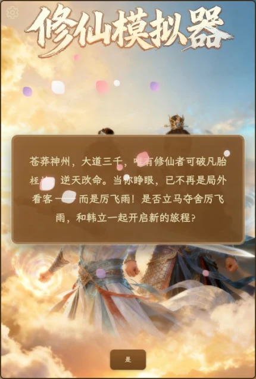
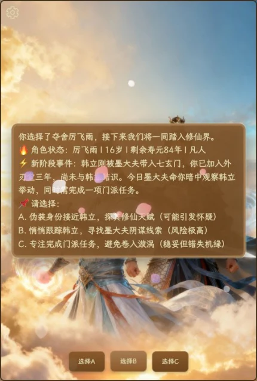
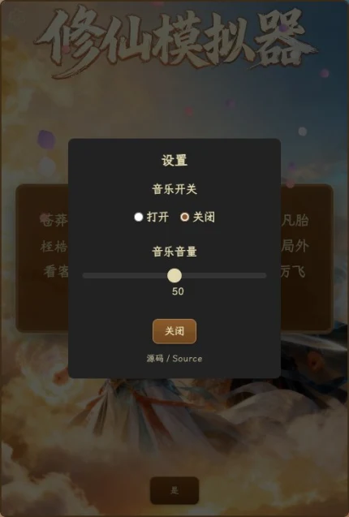

<div align="center">


# 凡人修仙传之我是厉飞雨

**A xianxia text RPG that ships as one Cloudflare Worker — Workers AI narrates, the browser owns the story, and a single daily budget protects the account.**

<a href="https://xiuxian.wordtk.com"></a>

<br/>


<br/><br/>

🇺🇸 **English** &nbsp;·&nbsp; [🇨🇳 简体中文](README.zh-CN.md)

<br/>



</div>

> You wake up as **Li Feiyu**, a blade disciple of the Seven Mysteries Sect, three
> years before Han Li arrives. Every scene is written by a language model from a
> verbatim 2,929-character persona prompt plus a short runtime contract: age, lifespan and cultivation stage are
> advanced by the model, not by a script. You pick **A / B / C**, and the story
> moves forward — through the sect, the mortal world, and eventually the tribulation.

The game has no account, no database and no per-user limits. The only thing the
server remembers is one number per day: how much of the site-wide experience
budget has been spent.

---

## Table of contents

| | |
| --- | --- |
| [What it is](#what-it-is) | [Screens](#screens) |
| [Architecture](#architecture) | [Quick start](#quick-start) |
| [Model providers](#model-providers) | [Daily budget](#daily-budget) |
| [API](#api) | [Deploy](#deploy) |
| [Project layout](#project-layout) | [License](#license) |

---

## What it is

- **One page, one Worker** — the H5 interface (opening video, drifting petals,
  typewriter prose, music, settings) is served as static assets; only `/api/*`
  reaches the Worker.
- **Stateless backend** — the browser keeps the last **15 exchanges** and replays
  them with each request. Reload the page and you start a new run; the Worker
  stores nothing about your story.
- **Provider-agnostic** — Workers AI by default (zero keys), or any
  OpenAI-compatible endpoint (`LLM_BASE_URL` + `LLM_MODEL` + a secret). Same
  frontend, same game, different narrator.
- **One gate, no rate limits** — a site-wide daily budget in KV. No per-IP, no
  per-minute, no per-session counter. Reset at UTC midnight.
- **Invariants under test** — `npm run verify` pins the persona prompt length,
  the SSE contract, the budget arithmetic, the asset graph and the "no personal
  IDs" rules.

## Screens

<div align="center">

| In-game: status, event, three choices | Settings: music, volume, source link |
| --- | --- |
|  |  |

</div>

The prose format is also the protocol: the frontend splits on `📌` and renders a
button for every line starting with `A.` / `B.` / `C.`. The `🔥 当前状态` line
carries age, remaining lifespan and cultivation stage, so the model can restore
the whole game state from the replayed history alone.

## Architecture

```text
Browser  (public/ — static, cached by Cloudflare, zero Worker invocations)
  ├─ keeps the last 15 exchanges in memory
  └─ POST /api/chat  { sessionId, choice, history }
                │
Worker   (server/ — starts on /api/* only)
  ├─ validate choice, sanitize and re-trim history (30 messages max)
  ├─ daily budget check        KV  quota:neurons:YYYY-MM-DD
  ├─ provider                  env.AI.run(...)  |  POST {LLM_BASE_URL}/chat/completions
  └─ SSE                       data: {"text":"…","done":true}
                │
Frontend ─ typewriter reveals the text ─ renders A/B/C buttons
```

Two Cloudflare products, no database:

| Binding | Purpose |
| --- | --- |
| `QUOTA` (KV) | one JSON document per day and unit; the only persistent state |
| `AI` (Workers AI) | optional — unused when an OpenAI-compatible endpoint is configured |

Why the response is non-streaming: the upstream call returns the full completion,
and the browser's typewriter produces the progressive reveal. That keeps a single
response shape and a single failure mode, at the same perceived latency as a real
stream's first token.

## Quick start

```bash
npm install

# 1. create the budget ledger and copy the id into wrangler.toml
npx wrangler kv namespace create xiu-xian-game

# 2. run locally (GAME_STUB=1 skips the model but keeps validation + budget)
npx wrangler dev --var GAME_STUB:1
# open http://localhost:8787
```

To test against a real model locally, run `npx wrangler dev --remote`: the local
miniflare proxy cannot reach the AI binding, so `--remote` executes the Worker on
Cloudflare's edge with the real bindings (this writes to the real KV namespace).

`npm run check` runs `tsc`; `npm run verify` runs the invariant suite.

## Model providers

| Provider | Selected by | Default model | Unit |
| --- | --- | --- | --- |
| Cloudflare Workers AI | the `AI` binding (default) | `@cf/qwen/qwen3-30b-a3b-fp8` | neurons |
| OpenAI-compatible | `LLM_BASE_URL` | `gpt-4o-mini` | tokens |

Environment variables (see [`docs/en/configuration.md`](docs/en/configuration.md)
for the full table and examples):

| Variable | Required | Meaning |
| --- | --- | --- |
| `LLM_PROVIDER` | no | `cloudflare` or `openai`; inferred when omitted |
| `LLM_BASE_URL` | OpenAI-compatible only | e.g. `https://api.deepseek.com/v1` |
| `LLM_API_KEY` | usually | Worker **secret**; never committed |
| `LLM_MODEL` | no | model id |
| `GAME_STUB` | no | `1` = no model call |

Switching to DeepSeek, for example:

```toml
# wrangler.toml
[vars]
LLM_BASE_URL = "https://api.deepseek.com/v1"
LLM_MODEL = "deepseek-chat"
```

```bash
npx wrangler secret put LLM_API_KEY
npx wrangler deploy
```

`GET /api/health` reports the active provider, model and remaining budget — a
quick way to confirm a switch without spending a turn.

## Daily budget

The only cost control in the project. It is **site-wide**, not per visitor:

| Provider | Daily budget | Why this number |
| --- | --- | --- |
| Workers AI | **4,000 neurons** | a 100-turn run costs ≈3,478 neurons with a 15-exchange window, leaving ~16 turns of headroom out of a 10,000/day free account allowance |
| OpenAI-compatible | **600,000 tokens** | a 100-turn run is ≈501k tokens; the rest is slack for longer replies |

A request is rejected with HTTP 503 and a readable message once the day's budget
is used up; the ledger expires on its own after seven days. The unit follows the
provider, so switching models mid-day does not corrupt the counter.

> ⚠️ **KV is eventually consistent.** There is no atomic increment, so a burst of
> concurrent requests can overshoot the budget slightly. That is the deliberate
> price of not adding D1 or a Durable Object to a one-Worker game. If you need a
> hard cap, replace `server/quota.ts` with a Durable Object.

Why 15 exchanges: every turn re-reads the replay window, so the window is the
cost knob. At 15 exchanges a steady-state turn costs ≈36 neurons; the full
100-turn arc still fits in one day's budget.

## API

| Method | Path | Body | Response |
| --- | --- | --- | --- |
| `POST` | `/api/chat` | `{ sessionId?, choice, history? }` | SSE `data: {"text":"…","done":true}` |
| `GET` | `/api/health` | — | provider, model and quota snapshot |

Errors use one envelope:

```json
{ "ok": false, "error": { "code": "game-budget-exhausted", "message": "今日体验额度已用完，明天再来吧。" } }
```

`choice` is `是` for the opening and a bare `A` / `B` / `C` afterwards. `history`
is untrusted: invalid entries are dropped, messages are truncated to 4,000
characters, and the array is trimmed to the newest 30 messages.

## Deploy

```bash
npx wrangler kv namespace create xiu-xian-game   # once; put the id in wrangler.toml
npx wrangler deploy
```

`wrangler.toml` binds the Worker to `xiuxian.wordtk.com` as a Custom Domain and
keeps `workers.dev` disabled. Change the `[[routes]]` pattern (the zone must be
on the same Cloudflare account) and redeploy; the Worker code has no hard-coded
host — the same-origin check compares against the incoming request host.

## Project layout

```text
public/               static H5 game (HTML, CSS, JS, audio, video, fonts)
  js/game.js          replay window, SSE parsing, typewriter, petals
  assets/             opening video, backgrounds, BGM, full CJK font
server/
  index.ts            Worker entry: /api/chat, /api/health, same-origin guard
  game.ts             validate → budget → replay window → model → ledger
  ai.ts               provider resolution + the two call paths
  quota.ts            KV daily ledger (soft cap, documented)
  limits.ts           budgets, neuron rates, token estimation
  prompt.ts           the 2,929-character persona prompt + runtime contract
scripts/verify.mts    invariant checks (prompt, SSE, budget, assets, hygiene)
docs/                 logo, screenshots, en/ and zh-CN/ configuration notes
```

## License

**AGPL-3.0-only** — see [`LICENSE`](LICENSE). If you run a modified version as a
network service, that version must offer its source under the same license; the
in-game settings panel links back here for that reason.

A **commercial license** (closed-source use, private deployment, resale) is
available separately. Open an issue on this repository or reach out through
[@onblog](https://github.com/onblog). The commercial option covers this
codebase only; the novel's setting and characters remain with their rights
holders.

Copyright © 2026 Martin.

## Disclaimer

A non-commercial fan project. *凡人修仙传* is a novel by 忘语 (Wang Yu); this
project is not affiliated with or endorsed by the author or the rights holders.
